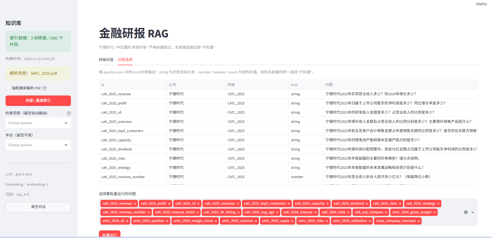

## 📌 项目简介
基于 LangChain 与智谱 GLM-4 构建的企业级 RAG 问答系统，解决超长 PDF 解析、跨公司实体对比、数值指标易串号等痛点。

## 🏗️ 效果展示
  

## 🛠️ 技术栈
- **框架**：LangChain (LCEL), Streamlit
- **大模型**：智谱 GLM-4 / Embedding-3
- **向量库**：FAISS
- **其他**：PyMuPDF, Python

## 💡 核心实现
1. **父子文档切片 (Small-to-Big)**：子块用于向量检索保证精度，父块用于回捞补全上下文。
2. **多实体隔离建库**：按公司建立独立 FAISS 物理索引，前置 LLM 意图路由，杜绝跨文档数据串号。
3. **Rerank 精排**：引入重排模型对候选上下文二次打分，过滤噪声，降低幻觉。

## ⚙️ 配置与运行
1. 复制 `.env.example` 为 `.env`，填入 `ZHIPU_API_KEY`。
2. 安装依赖：`pip install -r requirements.txt`
3. 运行前端：`streamlit run app.py`
